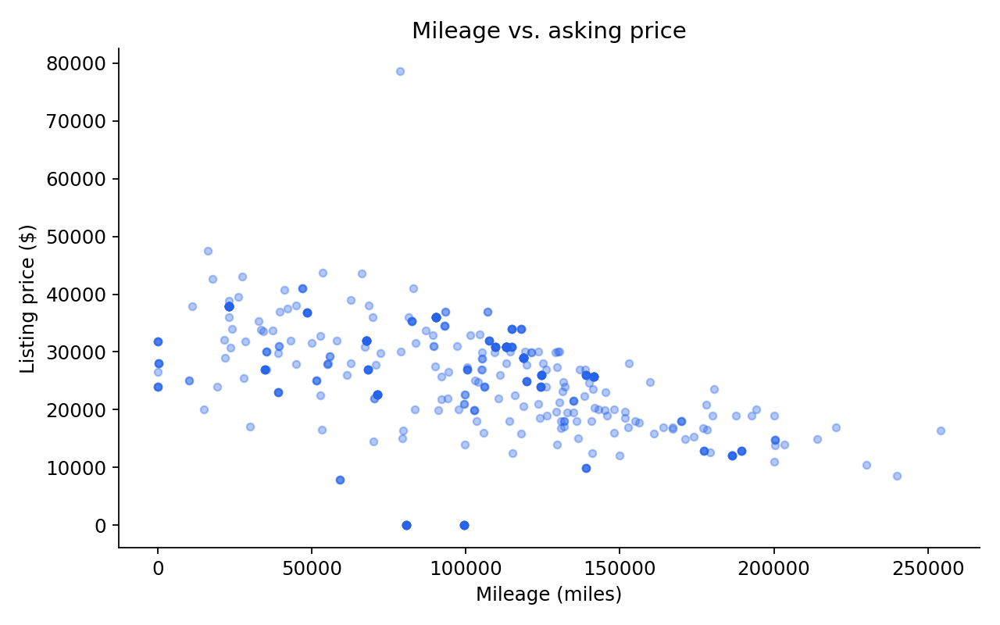

# Predicting Used Chevrolet Silverado Prices with R

**Exploratory analysis · Multiple linear regression · Polynomial models · Model diagnostics · Holdout validation**

This project investigates how **age and mileage relate to asking prices** for used Chevrolet Silverado 1500 trucks listed in the southeastern United States. It develops interpretable baseline regressions, compares nonlinear alternatives, checks regression assumptions, and evaluates prediction error on unseen listings.



## At a glance

- **Data:** 461 Silverado 1500 listings, model years 2010–2019, across 7 states, filtered from the supplied `vehiclesSE.csv`.
- **Outcome:** Listing price (USD), not confirmed sale price.
- **Predictors:** Age in 2021, odometer mileage; state retained for potential extensions.
- **Methods:** OLS, polynomial features, nested F-tests, residual diagnostics, and reproducible 80/20 holdout testing.

## Model comparison (in-sample)

| Model                 |   R-squared |   Adjusted R-squared |    AIC |
|:----------------------|------------:|---------------------:|-------:|
| Mileage only          |       0.21  |                0.208 | 9653.4 |
| Age only              |       0.212 |                0.211 | 9651.8 |
| Age + mileage         |       0.277 |                0.273 | 9614.6 |
| Quadratic age         |       0.229 |                0.226 | 9643.8 |
| Complete second order |       0.31  |                0.302 | 9599   |

*These statistics were independently recalculated from the supplied data. R-squared measures fit on the full analysis dataset, not test-set performance.*

## Questions explored

1. How much of the variation in asking prices is associated with mileage and age?
2. Does adding age improve a mileage-only regression?
3. Do quadratic or interaction terms justify their added complexity?
4. How stable are predictions on a held-out sample?
5. Do residuals and influential observations reveal modeling limitations?

## Repository contents

```text
.
├── README.md
├── analysis.Rmd                  # Complete reproducible R report
├── requirements.R               # Install R dependencies
├── data/
│   ├── silverado_1500_clean.csv # Small, ready-to-use analysis dataset
│   └── model_comparison.csv     # Verified in-sample model metrics
├── figures/
│   ├── mileage_vs_price.png
│   └── age_vs_price.png
└── archive/
    └── original-homework.Rmd    # Original work for provenance
```

## Run it

1. Install R and (optionally) RStudio.
2. From the repository root, run `source("requirements.R")` to install packages.
3. Run `rmarkdown::render("analysis.Rmd")` or open the report in RStudio and click **Knit**.
4. Open `analysis.html` to see the finished interactive-table-of-contents report.

**No external dataset download required:** the filtered CSV is included. The full original `vehiclesSE.csv` is omitted because it is about 235 MB and is unnecessary for reproducing these models.

## What I learned

This project demonstrates how to translate a raw listing dataset into a defensible statistical workflow: define the sample, fit and interpret regression models, formally test additional terms, inspect assumptions, and distinguish in-sample fit from holdout accuracy.

## Limitations

Prices are advertisements, not transactions. This is observational data, and associations should not be interpreted as causal effects. The 2021 age reference follows the original analysis. A future iteration could include vehicle condition, trim, regional market effects, and time-aware validation.

## Provenance

Refactored from a course R Markdown analysis. The original submission is retained in `archive/`; all displayed summary metrics here were recomputed from the provided CSV using the consistently filtered Silverado 1500 sample. The R report itself has **not** been executed in this environment because R is not installed.
